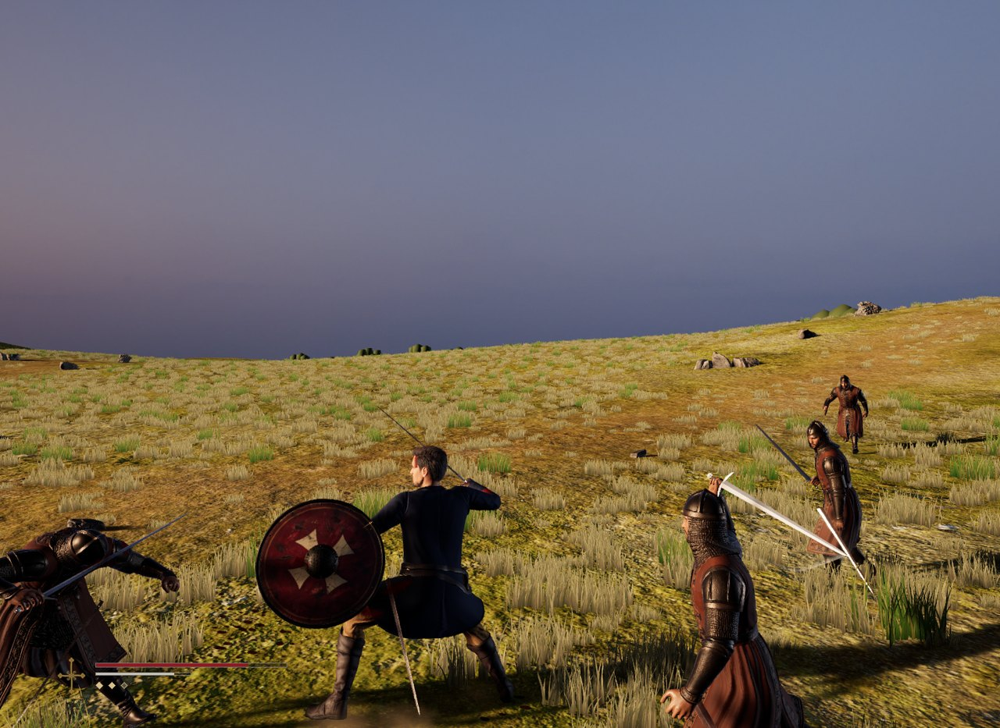
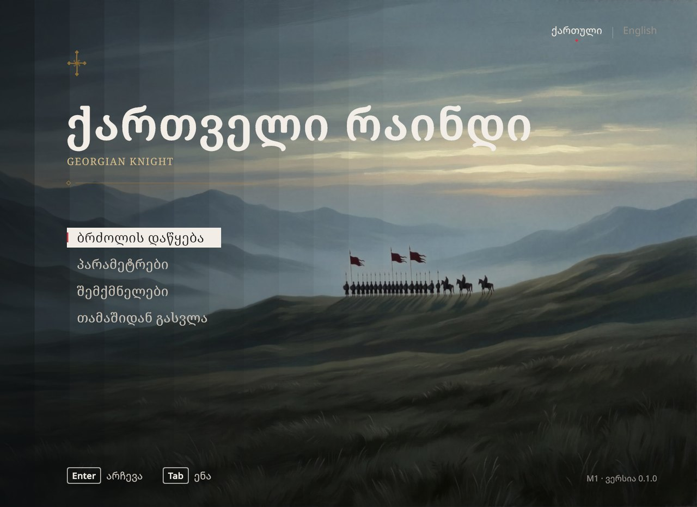
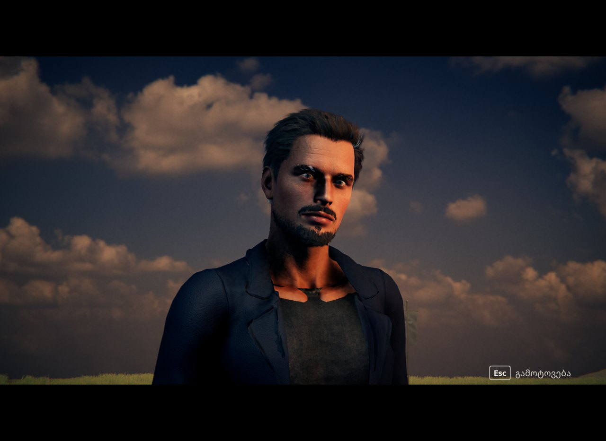
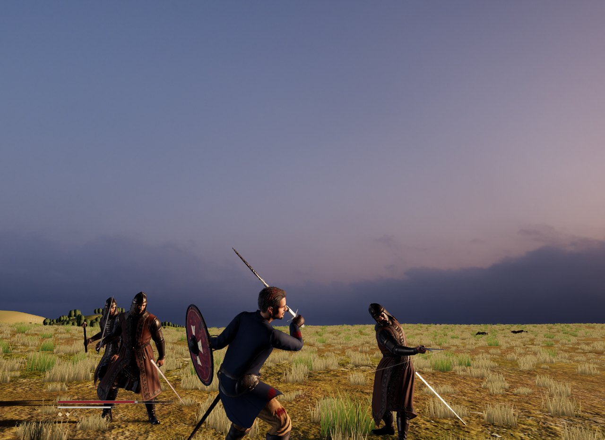
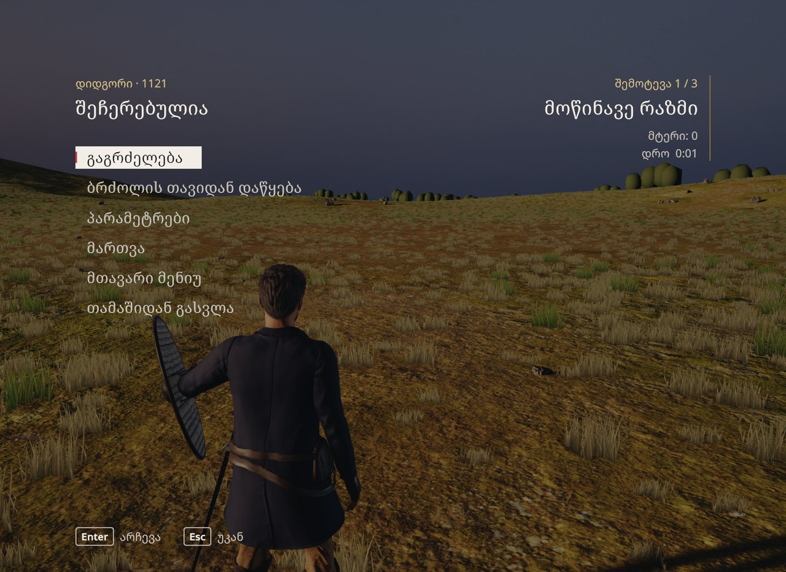
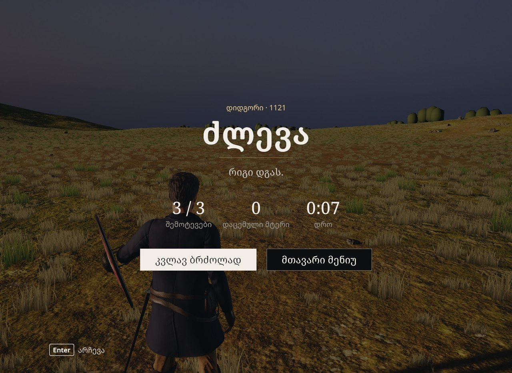

# ქართველი რაინდი

**Georgian Knight** · Unity 6 · URP · C#

მესამე პირის საბრძოლო თამაში დიდგორის ბრძოლაზე (1121). ხმალი და ფარი სელჩუკთა ლაშქრის წინააღმდეგ:
სამი შემოტევა, შესავალი ფილმი, მენიუ ქართულად და ინგლისურად.

| | | |
|---|---|---|
|  |  |  |
|  |  | |

## მართვა

| | კლავიატურა და თაგვი | პულტი |
|---|---|---|
| მსუბუქი / მძიმე დარტყმა | მარცხენა / მარჯვენა ღილაკი | X / Y |
| დაცვა, მოგერიება | Q | LB |
| აცილება | Space | A |
| დამიზნება | შუა ღილაკი | R3 |
| წიხლი | F | RB |
| ხმალი და ფარი / მარტო ხმალი | 1 / 2 | ◀ / ▶ |
| პაუზა | Esc | Start |

## გაშვება

Unity **6000.0.74f1** · სცენა `Assets/_GeorgianKnight/Scenes/MainMenu.unity`

რეპოზიტორიაში არ შედის მესამე მხარის მასალა, რომლის საჯარო გავრცელებასაც ლიცენზია არ უშვებს (გმირის მოდელი,
ანიმაციები, ხმები). წყაროები და ლიცენზიები: [`CREDITS.txt`](Assets/_GeorgianKnight/CREDITS.txt).
